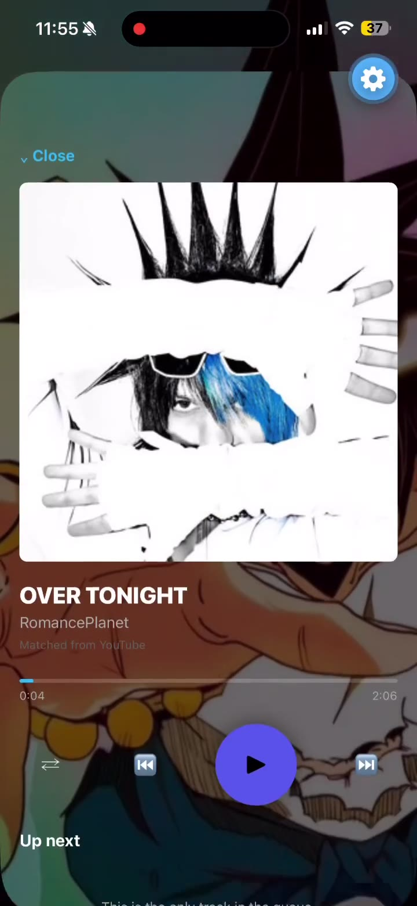

# DropWave

Offline-first personal music app, built with **Muse**. Published here as a portfolio showcase of the work, the same way I share my Claude and Codex builds.

Built for personal use for me and a couple of friends. Not monetized and not published to an app store.

Saved to GitHub on October 13, 2026 in its current state, as-is.

## Demo

44-second walkthrough on a real iPhone: playing a downloaded track, the Download and Library tabs, and the Style tab (glossy/matte finish, accent and button colors, home backgrounds), all while the music keeps playing in the mini player.

https://github.com/user-attachments/assets/ea209d6c-e8e4-408c-8285-426e9290726d

Player not loading? The same clip lives in this repo at [`docs/demo/dropwave-demo.mp4`](docs/demo/dropwave-demo.mp4).

<a href="docs/demo/dropwave-demo.mp4"></a>

## What it is

- Expo / React Native app (Expo SDK 57, React 19, TypeScript) in `app/`
- Python FastAPI backend in `backend/` that resolves a shared track link, matches it, and returns audio for the app to download onto the device
- Audio files live on the device, not on the backend
- SQLite library, queue, downloads, and playback session work lives in `db/`, `audio/`, `downloads/`, and `lib/`
- Backend tests in `backend/tests/`

## Current status (honest)

- Gloss fix and foreground library/playback migration were done in October 2026.
- Background and lock-screen playback were still not working in Expo Go at the time this was saved. That needs a development build with the `audio` background mode, which had not been completed.
- Several risks noted in `docs/ENGINEERING_PROGRESS.md` and `docs/ERROR_TAXONOMY.md` were still open. Read those before treating anything here as finished.

## Run it

App:

```bash
npm install
npx expo start
```

Backend:

```bash
cd backend
./start-backend.sh
```

Typecheck:

```bash
npx tsc --noEmit
```
